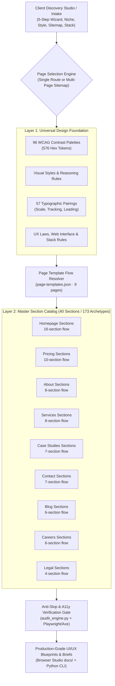

# Multi-Page UI/UX Intelligence System — Master Implementation Plan

> **Project:** UI/UX Pro Max Engine  
> **Repository:** Root (`skills/ui-ux-pro-max/`, `components/`, `docs/`)  
> **Current Milestone:** 13 of 13 Core & Detail Pages Complete (100% Complete — Live in Static Studio & Python API)  
> **Current Scale:** 43 Sections · 188 Archetypes · 0 Critical Audit Errors  
> **Compliance Standard:** WCAG 2.2 AA / AAA · Anti-Slop Rubric (SLOP-001 to SLOP-006)

---

## 1. Executive Summary & Architecture

This implementation plan documents the multi-page design intelligence system. The system translates high-level client discovery intake into deterministic, token-level UI/UX blueprint prompts across 9 core page templates (`home`, `pricing`, `about`, `services`, `case_studies`, `contact`, `blog`, `careers`, `legal`).



---

## 2. Current Completion Status

| Page Template | Route | Sections in Flow | Status | Artifact / Script Link |
|---|---|:---:|:---:|---|
| **01. Homepage** | `/` (`home`) | 16 | Complete | [page-templates.json](skills/ui-ux-pro-max/data/page-templates.json) |
| **02. Pricing** | `/pricing` (`pricing`) | 10 | Complete | [add_pricing_page_sections.py](skills/ui-ux-pro-max/scripts/migrations/add_pricing_page_sections.py) |
| **03. About Us** | `/about` (`about`) | 8 | Complete | [add_about_page_sections.py](skills/ui-ux-pro-max/scripts/migrations/add_about_page_sections.py) |
| **04. Services & Solutions** | `/services` (`services`) | 8 | Complete | [add_services_page_sections.py](skills/ui-ux-pro-max/scripts/migrations/add_services_page_sections.py) |
| **05. Case Studies Hub** | `/case-studies` (`case_studies`) | 7 | Complete | [add_case_studies_page_sections.py](skills/ui-ux-pro-max/scripts/migrations/add_case_studies_page_sections.py) |
| **06. Contact & Intake** | `/contact` (`contact`) | 7 | Complete | [add_contact_page_sections.py](skills/ui-ux-pro-max/scripts/migrations/add_contact_page_sections.py) |
| **07. Blog & Resources** | `/blog` (`blog`) | 6 | Complete | [add_blog_page_sections.py](skills/ui-ux-pro-max/scripts/migrations/add_blog_page_sections.py) |
| **08. Careers & Jobs** | `/careers` (`careers`) | 6 | Complete | [add_careers_page_sections.py](skills/ui-ux-pro-max/scripts/migrations/add_careers_page_sections.py) |
| **09. Legal & Compliance** | `/legal` (`legal`) | 4 | Complete | [add_legal_page_sections.py](skills/ui-ux-pro-max/scripts/migrations/add_legal_page_sections.py) |
| **10–13. Kinetic Agency & Detail Routes** | `product_showcase`, `product_detail`, `service_detail`, `case_study_detail` | 6–9 | Complete | [add_kinetic_agency_sections.py](skills/ui-ux-pro-max/scripts/migrations/add_kinetic_agency_sections.py) |

---

## 3. Executed Implementation Phases

### Phase 1: Dedicated Careers & Talent Acquisition Page (`/careers`)

**Objective:** Build a talent attraction engine that communicates compensation transparency, culture, benefits, and open requisitions without corporate platitudes.

#### 1.1 Dedicated Section Archetypes Implemented
1. **`careers_perks` (4 Archetypes):**
   - `perk-01`: **4-Column High-Trust Benefits Grid**
   - `perk-02`: **Compensation Philosophy Manifesto**
   - `perk-03`: **Remote-First Stipend Matrix**
   - `perk-04`: **Parental & Wellness Commitment Banner**
2. **`careers_jobs` (3 Archetypes):**
   - `jobs-01`: **Department Filterable Requisition Board**
   - `jobs-02`: **Single Requisition Expandable Accordion**
   - `jobs-03`: **Interview Pipeline & Transparent Process Stepper**

#### 1.2 Execution Status
- [x] Create `scripts/add_careers_page_sections.py`
- [x] Append `careers_perks` and `careers_jobs` into `data/section-archetypes.json`
- [x] Sync `data/section-archetypes.csv`
- [x] Update `careers` section flow in `data/page-templates.json`
- [x] Add selection triggers (`remote_stipend`, `salary_transparent`, `accordion_jobs`, `interview_pipeline`)
- [x] Verify end-to-end generation & `system_audit.py`

---

### Phase 2: Dedicated Legal, Privacy & Compliance Hub (`/legal`)

#### 2.1 Dedicated Section Archetypes Implemented
1. **`legal_doc` (3 Archetypes):** `leg-01`, `leg-02`, `leg-03`.

#### 2.2 Execution Status
- [x] Create `scripts/add_legal_page_sections.py`
- [x] Append `legal_doc` (3 archetypes) into `data/section-archetypes.json`
- [x] Sync `data/section-archetypes.csv` (173 total archetypes across 40 sections)
- [x] Update `legal` section flow in `data/page-templates.json`
- [x] Add selection triggers (`has_toc`, `has_version_selector`, `multi_policy`)
- [x] Verify `system_audit.py` (`100.0/100`)

---

### Phase 3: Child Detail Extensions (Optional Scope-Only Routes in Discovery Studio)

Custom routes such as `case_study_detail`, `blog_post_detail`, `Individual Service Detail Pages`, `Portfolio Showcase`, `Standalone FAQ Hub`, and `Resources / Downloads Hub` are selectable as scope-only sitemap pages inside the [docs/ Discovery Studio](docs/README.md).

---

### Phase 4: Schema Normalization & Technical Debt Remediation (Complete)

* [x] Added normalized `style_id`, `landing_id`, and `product_slug` foreign key columns in [products.csv](skills/ui-ux-pro-max/data/products.csv).
* [x] Generated [product-type-mapping.json](skills/ui-ux-pro-max/data/product-type-mapping.json) via `normalize_products_dataset.py`.
* [x] Removed all deprecated `Neumorphism` recommendations (`0` in `ui-reasoning.csv` and `products.csv`).
* [x] Verified **0 FK warnings** across all 96 rows via `system_audit.py`.

---

### Phase 5: Production Evaluation Harness (Complete)

* [x] Built [eval_golden_set.py](skills/ui-ux-pro-max/scripts/eval_golden_set.py) with 30 reference client briefs (`Enterprise`, `Agency`, `GrowthSaaS`).
* [x] Achieved **100.00/100** average score (`Target >= 95.00`, all `30/30` briefs `>= 95/100`).

---

### Phase 6: Missing Enterprise Component Library & Static Studio Workbench (Complete)

* [x] [PatternDataTable.tsx](components/patterns/PatternDataTable.tsx)
* [x] [PatternFormEngine.tsx](components/patterns/PatternFormEngine.tsx)
* [x] [PatternAppShell.tsx](components/patterns/PatternAppShell.tsx)
* [x] [PatternChartRow.tsx](components/patterns/PatternChartRow.tsx)
* [x] Runnable Vite + React demo host in [apps/demo/](apps/demo/src/App.tsx)
* [x] Zero-backend Multi-Page Studio Workbench in [docs/](docs/index.html)

---

## 4. Anti-Slop Rule Index Reference

Canonical rules `SLOP-001..006`, `TOKEN-001..002`, `PERF-001`, and `A11Y-001..008` are enforced deterministically in [scripts/audit_engine.py](scripts/audit_engine.py) (`19` active rules). See [WORKFLOW.md](WORKFLOW.md) for the authoritative catalog.

---

## 5. Quick-Start Verification Commands

```bash
# 1. Verify dataset, FK, and archetype integrity (100.0/100)
npm run audit:system

# 2. Rebuild docs/ studio bundle after any dataset change
python scripts/build_studio_bundle.py

# 3. Run full 7-suite verification (TS, System Audit, AST Audit, Golden Eval, Unit, E2E, Studio)
npm test
```
