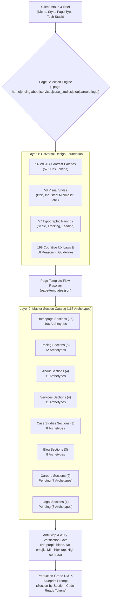

# Multi-Page UI/UX Intelligence System — Master Implementation Plan

> **Project:** UI/UX Pro Max Engine  
> **Repository:** `D:\gemini\gemini-uiux-kit\`  
> **Current Milestone:** 6 of 8 Core Pages Complete (75% Complete)  
> **Current Scale:** 37 Sections · 163 Archetypes · 0 Critical Audit Errors  
> **Compliance Standard:** WCAG 2.2 AA / AAA · Anti-Slop Rubric (SLOP-001 to SLOP-006)

---

## 1. Executive Summary & Architecture

This implementation plan documents the roadmap to complete the multi-page design intelligence system. The system translates high-level client discovery intake into deterministic, token-level UI/UX blueprint prompts across any modern website page type.



---

## 2. Current Completion Status

| Page Template | Route | Sections | Archetypes | Status | Artifact / Script Link |
|---|---|:---:|:---:|:---:|---|
| **01. Homepage** | `/` | 15 | 106 | ✅ **Complete** | [master_prompt_v2.md](file:///D:/gemini/master_prompt_v2.md) |
| **02. Pricing** | `/pricing` | 10 | 12 new | ✅ **Complete** | [pricing_page_prompt.md](file:///D:/gemini/pricing_page_prompt.md) |
| **03. About Us** | `/about` | 12 | 11 new | ✅ **Complete** | [about_page_prompt.md](file:///D:/gemini/about_page_prompt.md) |
| **04. Services & Solutions** | `/services` | 13 | 11 new | ✅ **Complete** | [services_page_prompt.md](file:///D:/gemini/services_page_prompt.md) |
| **05. Case Studies Hub** | `/case-studies` | 8 | 8 new | ✅ **Complete** | [case_studies_page_prompt.md](file:///D:/gemini/case_studies_page_prompt.md) |
| **06. Blog & Resources** | `/blog` | 6 | 8 new | ✅ **Complete** | [blog_page_prompt.md](file:///D:/gemini/blog_page_prompt.md) |
| **07. Careers & Jobs** | `/careers` | 7 | 7 new | ⏳ **Pending** | *Scheduled Phase 1 below* |
| **08. Legal & Compliance** | `/legal` | 3 | 3 new | ⏳ **Pending** | *Scheduled Phase 2 below* |

---

## 3. Remaining Implementation Phases

### Phase 1: Dedicated Careers & Talent Acquisition Page (`/careers`)

**Objective:** Build a talent attraction engine that communicates compensation transparency, culture, benefits, and open requisitions without corporate platitudes.

#### 1.1 Dedicated Section Archetypes to Build
1. **`careers_perks` (4 Archetypes):**
   - `perk-01`: **4-Column High-Trust Benefits Grid** — Categorized cards: Compensation & Equity, Health & Family, Workspace & Setup Stipends, Time Off & Sabbaticals.
   - `perk-02`: **Compensation Philosophy Manifesto** — Transparent band formula, geographic tiering explanation, open salary bands, and equity refreshers.
   - `perk-03`: **Remote-First Stipend Matrix** — Breakdown of home office setup budget ($2,000), annual learning budget ($1,500), co-working space pass.
   - `perk-04`: **Parental & Wellness Commitment Banner** — 16-week paid parental leave, mental health stipend, four-week annual company recharge.
2. **`careers_jobs` (3 Archetypes):**
   - `jobs-01`: **Department Filterable Requisition Board** — Sticky tabs: All, Engineering, Product, Design, Go-To-Market. Job cards display: Role title, Department, Location (Remote / Hybrid), Experience tier, and 'Apply ->' button.
   - `jobs-02`: **Single Requisition Expandable Accordion** — Inline accordion previewing role mission, 3 core responsibilities, qualifications, and direct application form without redirecting.
   - `jobs-03`: **Interview Pipeline & Transparent Process Stepper** — 4-step chronological pipeline: Recruiter Sync (30m) -> Technical Deep Dive (60m) -> Paid Take-Home or Pair Programming (2h) -> Executive Offer.

#### 1.2 Execution Tasks
- [ ] Create `scripts/add_careers_page_sections.py`
- [ ] Append `careers_perks` and `careers_jobs` (7 archetypes) into `data/section-archetypes.json`
- [ ] Sync `data/section-archetypes.csv` (170 total archetypes)
- [ ] Update `careers` section flow in `data/page-templates.json`
- [ ] Add selection triggers to `scripts/generate_section_prompt.py` (`--remote-stipend`, `--salary-transparent`, `--accordion-jobs`)
- [ ] Test end-to-end: `generate_section_prompt.py --page careers --out D:\gemini\careers_page_prompt.md`
- [ ] Re-run system audit and commit to git.

---

### Phase 2: Dedicated Legal, Privacy & Compliance Hub (`/legal`)

**Objective:** Deliver an audit-grade, high-legibility legal documentation center with zero unstyled walls of text.

#### 2.1 Dedicated Section Archetypes to Build
1. **`legal_doc` (3 Archetypes):**
   - `leg-01`: **Sticky Table of Contents & Prose Split** — Left (3 cols): Sticky scroll-spy navigation tracking active section anchors (Introduction, Data Collection, Third-Party Processors, GDPR Rights, Security Measures). Right (9 cols): Typographically optimized prose layout with strict 65-character line length.
   - `leg-02`: **Tabbed Policy Multi-Doc Hub** — Segmented control tab bar: Terms of Service, Privacy Policy, Sub-processors List, Acceptable Use Policy, Data Processing Addendum (DPA).
   - `leg-03`: **Versioned Compliance Header with PDF Download** — Top utility bar with: Last Modified timestamp, Version selector (e.g. `v2.4 (Active)`, `v2.3 (Archived)`), Plain-English Summary toggle, and Download Official PDF button.

#### 2.2 Execution Tasks
- [ ] Create `scripts/add_legal_page_sections.py`
- [ ] Append `legal_doc` (3 archetypes) into `data/section-archetypes.json`
- [ ] Sync `data/section-archetypes.csv` (173 total archetypes across 38 sections)
- [ ] Update `legal` section flow in `data/page-templates.json`
- [ ] Add selection triggers to `scripts/generate_section_prompt.py` (`--has-toc`, `--has-version-selector`, `--multi-policy`)
- [ ] Test end-to-end: `generate_section_prompt.py --page legal --out D:\gemini\legal_page_prompt.md`
- [ ] Re-run system audit and commit to git.

---

### Phase 3: Single Item Detail Page Extensions (Bonus)

**Objective:** Complete the individual deep-dive templates for child routes:

1. **`case_study_detail` (`/case-studies/[slug]`):**
   - Hero: Client, Problem Statement, Delivery Timeline, Team Composition.
   - Challenge vs. Solution Deep Dive with architecture diagrams.
   - Before/After Interactive Visual Comparison slider.
   - Deliverable tech stack pills and repository deliverables list.
   - Executive client video pull quote.
   - Next case study teaser footer.
2. **`blog_post_detail` (`/blog/[slug]`):**
   - Sticky scroll-progress bar at top of viewport.
   - Author byline with verified LinkedIn credential and technical reviewer credit.
   - High-contrast code syntax highlighting block with copy-to-clipboard button.
   - Pull quotes with direct 'Share to X/LinkedIn' button.
   - Related reading cards (3 articles from same topic cluster).

---

### Phase 4: Schema Normalization & Technical Debt Remediation (P1)

**Issue:** Currently, `products.csv` references styles and landing patterns using descriptive compound strings (e.g., `"Feature-Rich Showcase + Social Proof"`), producing 96 non-blocking foreign key warnings in the audit.

**Remediation Steps:**
1. Add normalized integer foreign key columns:
   - `products.csv`: add `style_id` (int), `landing_id` (int), `product_slug` (string PK).
2. Create `data/product-type-mapping.json` junction table:
   ```json
   {
     "b2b-saas-enterprise": {
       "style_ids": [1, 14],
       "landing_pattern_id": 4,
       "recommended_sections": ["hero", "pricing_comparison_matrix", "service_architecture"]
     }
   }
   ```
3. Update `scripts/system_audit.py` to validate against strict FK IDs.
4. Target: **Reduce FK warnings from 96 to 0**.

---

### Phase 5: Production Evaluation Harness (P2)

**Objective:** Build an automated test suite that validates prompt quality, token consistency, and anti-slop adherence against a golden set of real-world briefs.

1. **Create `scripts/eval_golden_set.py`:**
   - 30 diverse reference client briefs:
     - 10 B2B Enterprise & Infrastructure (AWS/Stripe caliber)
     - 10 High-Craft Creative Studios & Agencies (Pentagram/Work&Co caliber)
     - 10 Consumer & Growth SaaS (Figma/Linear caliber)
2. **Automated 5-Axis Scoring Rubric (100-point scale):**
   - **Section Relevance & Flow (25 pts):** Zero redundant or misplaced sections.
   - **Token Integrity (20 pts):** All hex values valid, typography weights specified, motion curves bound.
   - **WCAG 2.2 Compliance (25 pts):** Strict contrast >= 4.5:1 (>= 7:1 for headers), touch targets >= 44px.
   - **Anti-Slop Compliance (20 pts):** Zero violations of SLOP-001 through SLOP-006.
   - **Engineering Readiness (10 pts):** Real semantic HTML5 elements (`<article>`, `<nav>`, `<aside>`, `<dl>`).
3. **Pass Criteria:** Average score >= 95/100 across all 30 briefs.

---

### Phase 6: Missing Enterprise Component Library Additions (P2)

Currently, `gemini-uiux-kit/components/` has 15 landing page components. To support enterprise web applications and complex pages, build the 4 missing components:

1. `components/patterns/PatternDataTable.tsx`:
   - Accessible virtualized table with column sorting, search filtering, sticky headers, and keyboard row navigation.
2. `components/patterns/PatternFormEngine.tsx`:
   - Accessible form container with inline validation, aria-invalid tracking, and error recovery banners.
3. `components/patterns/PatternAppShell.tsx`:
   - Collapsible navigation sidebar, top breadcrumb bar, user profile dropdown, and notification drawer.
4. `components/patterns/PatternChartRow.tsx`:
   - Accessible SVG sparkline and area chart component bound to semantic design tokens.

---

## 4. Anti-Slop Rule Index Reference

All generated prompts must enforce the 6 immutable rules:

| Rule ID | Name | Prohibited Pattern | Required Alternative |
|---|---|---|---|
| **SLOP-001** | Radioactive Blobs | Purple/cyan blurry radial gradient backgrounds (`filter: blur(100px)`) | Clean semantic card borders (`border-[var(--border-subtle)]`), solid slate backgrounds |
| **SLOP-002** | Emoji Clipart | Using emojis as UI icons (🚀, ✨, 🔥, 💡) | Crisp 24x24 SVG icons with 1.5px stroke width |
| **SLOP-003** | Shouting Badges | Neon pulsating 'NEW ✨' or 'HOT 🔥' badges | Subdued monospaced chips (`text-xs font-mono uppercase tracking-wider`) |
| **SLOP-004** | Gradient Paragraphs | Rainbow gradient text fills on long-form copy | Solid high-contrast text tokens (`#F8FAFC` or `#020617`, min 7:1 contrast) |
| **SLOP-005** | Fragile Contrast | Low-contrast grey-on-grey text or hairline borders | Strict WCAG 2.2 AA compliant tokens (min 4.5:1 for body, 7:1 for headers) |
| **SLOP-006** | Micro Touch Targets | Sub-44px buttons and cramped interactive links | Minimum 44x44px interactive tap target with 2px offset focus rings |

---

## 5. Quick-Start Guide for Resuming

When ready to resume work on the next phase, run:

```powershell
# 1. Verify current system health
python D:\gemini\gemini-uiux-kit\skills\ui-ux-pro-max\scripts\system_audit.py

# 2. Check current page template flows
cat D:\gemini\gemini-uiux-kit\skills\ui-ux-pro-max\data\page-templates.json

# 3. Resume with Phase 1 (Careers Page builder)
python D:\gemini\gemini-uiux-kit\skills\ui-ux-pro-max\scripts\add_careers_page_sections.py
```
