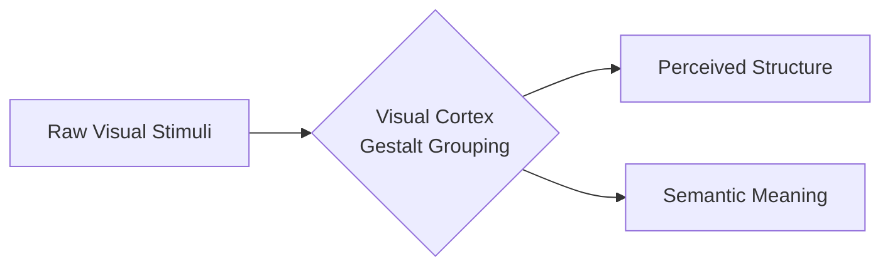

# Cognitive Psychology & Laws of UX

A scientific foundation for user interface design based on cognitive psychology, perceptual neuroscience, and human-computer interaction (HCI) research.

---

## 1. Gestalt Principles of Visual Perception

The human visual cortex does not perceive elements in isolation; it groups them into unified wholes using deeply ingrained perceptual rules:

### 1.1 Law of Proximity
* **Principle:** Objects placed close to each other are perceived as belonging to the same functional group.
* **UI Application:**
  - Related inputs and labels must have smaller margins (`mb-1.5` / 6px) than the gap between distinct form fields (`mb-6` / 24px).
  - Inside cards, the title and body copy must be closer together than the card's outer padding.
* **Failure Mode:** Spacing elements equally across a container destroys hierarchy and forces users to guess relationships.

### 1.2 Law of Similarity
* **Principle:** Elements sharing visual characteristics (color, shape, size, typography) are perceived as having the same role or importance.
* **UI Application:**
  - All primary action buttons must share identical styling across the entire application.
  - Secondary metadata should consistently use identical monospace or muted typography tokens.

### 1.3 Law of Common Region
* **Principle:** Elements enclosed within a visible boundary (card border, background container) are perceived as grouped, overriding proximity.
* **UI Application:**
  - Use surface cards (`border border-slate-200 dark:border-slate-800 bg-white dark:bg-slate-900`) to group complex, heterogeneous controls.

### 1.4 Law of Continuity
* **Principle:** The eye naturally follows lines, curves, and aligned edges.
* **UI Application:**
  - Keep form controls, labels, and text left-aligned to establish a single uninterrupted vertical scanning line.
  - Avoid staggered or zig-zag alignments that break the natural downward reading scan.

### 1.5 Law of Figure-Ground
* **Principle:** The brain divides visual fields into the focal object (figure) and the background surface (ground).
* **UI Application:**
  - Modals and slide-over drawers use semi-opaque backdrops (`bg-black/60`) and elevation shadows to push the page into "ground" and elevate the dialog to "figure".

---

## 2. Quantitative Behavioral Laws

### 2.1 Hick-Hyman Law (Decision Time)
$$T = b \cdot \log_2(n + 1)$$
* **Principle:** The time required to make a decision increases logarithmically with the number and complexity of choices ($n$).
* **UI Guidelines:**
  - Limit top-level navigation items to **5–7 options**.
  - Break long multi-field forms into sequential multi-step wizards or categorized accordions.
  - Highlight one recommended default option in pricing or setup flows to eliminate decision paralysis.

### 2.2 Fitts's Law (Target Acquisition)
$$MT = a + b \log_2\left(\frac{2D}{W}\right)$$
* **Principle:** Movement time ($MT$) to acquire a target depends on the distance ($D$) to the target and the target's width ($W$).
* **UI Guidelines:**
  - **Mobile Touch Footprint:** Every clickable/tappable element must meet a minimum $44 \times 44\text{px}$ touch target area.
  - **Screen Edges & Corners:** On desktop, screen edges have infinite virtual width because the cursor cannot overshoot the monitor boundary (e.g. macOS top menu bar, Windows start button).
  - **Thumb Zone:** On mobile devices, place primary CTAs within the bottom $30\%$ of the screen for one-handed thumb accessibility.

### 2.3 Miller's Law & Information Chunking
* **Principle:** The working memory of an average human can hold approximately $7 \pm 2$ chunks of information simultaneously.
* **UI Guidelines:**
  - Never display unformatted strings of digits. Chunk phone numbers (`+1 (555) 019-2834`), credit cards (`4532 ···· ···· 8921`), and license keys into 3–4 character segments.
  - Limit dashboard stat cards to 3–5 key metrics per row.

### 2.4 Jakob's Law of Internet User Experience
* **Principle:** Users spend most of their time on other sites. Therefore, users expect your interface to work the same way as all the other interfaces they already know.
* **UI Guidelines:**
  - Place navigation menus at the top or left, search inputs near the top-right or center, and shopping carts/profiles at the top-right.
  - Do not reinvent standard UI conventions (e.g. do not replace standard checkboxes with custom swiping gestures unless specifically justified).

---

## 3. Cognitive Load & Processing Models

### 3.1 Cognitive Load Theory (CLT)
Cognitive load represents the total mental effort exerted by working memory:
1. **Intrinsic Load:** The inherent difficulty of the task itself (e.g., configuring an IAM security policy). *Cannot be eliminated, but can be structured.*
2. **Extraneous Load:** Mental effort wasted on deciphering poor interface design (e.g., figuring out what an unlabelled icon means, or finding where the submit button moved). *Must be minimized to near-zero.*
3. **Germane Load:** Mental effort devoted to processing, learning, and forming schemas. *Should be supported by intuitive visual feedback.*

### 3.2 Dual Process Theory (System 1 vs System 2)
* **System 1 (Fast, Automatic, Heuristic):**
  - Operates when users scan a page in $<3$ seconds.
  - Relies on color conventions (red = error/destructive, green = success/active), icon silhouettes, and prominent CTA buttons.
* **System 2 (Slow, Deliberate, Analytical):**
  - Engages when users read technical specifications, enter payment details, or review legal terms.
  - Requires calm, high-contrast typography, clear tabular layouts, and progressive disclosure.

### 3.3 Doherty Threshold (<400ms Rule)
* **Principle:** Computer response times under **400ms** keep the user's attention anchored in the flow state, eliminating mental context switching.
* **UI Guidelines:**
  - Immediate visual feedback on click/press ($<50$ms tactile pushdown).
  - Provide optimistic UI updates or skeleton shimmer screens for async network calls exceeding 150ms.
  - For operations lasting $>2$ seconds, provide determinate percentage progress indicators.
