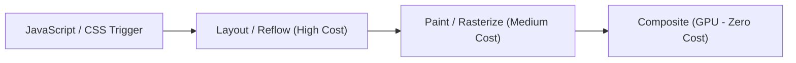

# Motion Physics & Animation Rules

Animation in modern UI should be purposeful, responsive, physically grounded, and executed strictly on the browser's GPU compositor thread.

---

## 1. Browser Rendering Pipeline Costs (CSS Motion Lab Standards)

Every CSS property animation carries a distinct performance tax depending on which phase of the browser rendering pipeline it triggers:



| Pipeline Tier | Animated Properties | Performance Cost | Frame Rate Guarantee |
|---|---|---|---|
| 🟢 **Tier 1: Compositing Only (GPU)** | `transform` (`translate3d`, `scale`, `rotate`), `opacity` | **Near Zero** (Executed on compositor thread without touching main thread) | **60fps – 120fps solid** |
| 🟡 **Tier 2: Paint (Rasterization)** | `background-color`, `box-shadow`, `color`, `border-color`, `outline` | **Medium** (Triggers layer repaint; acceptable for micro-interactions $<200$ms) | **60fps** on desktop; slight mobile tax |
| 🔴 **Tier 3: Layout / Reflow (Banned)**| `width`, `height`, `top`, `left`, `margin`, `padding`, `font-size` | **Prohibitive** (Forces full geometry recalculation across the DOM subtree) | **Causes frame drops & jank** |

> **The Golden Performance Rule:** If you need to expand or reposition an element, use `transform: scale(...)` or `transform: translate3d(...)` instead of animating `width` or `left`.

---

## 2. Standardized Cubic-Bézier Curves

Avoid generic `ease` or linear transitions. Use purpose-tuned Bézier curves:

| Motion Type | Timing Function / Curve | Use Cases |
|---|---|---|
| **Decelerate (Entrance)** | `cubic-bezier(0.0, 0.0, 0.2, 1)` | Modals appearing, dropdowns opening, toasts sliding in. Starts fast, slows smoothly to rest. |
| **Accelerate (Exit)** | `cubic-bezier(0.4, 0.0, 1, 1)` | Sheets closing, toasts dismissing. Leaves viewport briskly. |
| **Standard / Shift** | `cubic-bezier(0.4, 0.0, 0.2, 1)` | Accordion expand/collapse, card layout reflows, tab switches. |
| **Tactile Spring (Elastic)** | `cubic-bezier(0.34, 1.56, 0.64, 1)` | Button press release, badge popups, like heart pulses. |

---

## 3. Duration & Perception Budgets

Human visual perception perceives feedback in three distinct time buckets:
* **Micro-interactions (100ms – 150ms):** Button pushdowns, toggle flips, hover color changes, checkbox ticks. *Must feel instantaneous.*
* **Macro-transitions (200ms – 300ms):** Dropdown reveals, tooltips, tab panel transitions, accordion expansions.
* **Layout Overlays (300ms – 450ms):** Full-screen bottom sheets, centered modal backdrops, navigation drawer slides.
* ❌ *Never exceed 450ms for everyday application controls—users perceive delays beyond 500ms as sluggishness.*

---

## 4. The Backdrop-Blur Lag Antipattern

* **The Trap:** Animating the `opacity` of an element with `backdrop-filter: blur(...)` forces the GPU to re-filter and re-composite the entire screen pixels on every animation frame.
* **The Fix:** Keep the `backdrop-filter` layer mounted at a static opacity, and animate a plain color backdrop (`bg-black/40`) over it, or trigger the blur after the drawer has finished translating.

---

## 5. Universal Reduced-Motion Accessibility

Always include global safeguards for users with vestibular motion sensitivities:

```css
@media (prefers-reduced-motion: reduce) {
  *, ::before, ::after {
    animation-duration: 0.01ms !important;
    animation-iteration-count: 1 !important;
    transition-duration: 0.01ms !important;
    scroll-behavior: auto !important;
  }
}
```
In Framer Motion:
```tsx
import { useReducedMotion } from "framer-motion";

const shouldReduceMotion = useReducedMotion();
const transition = shouldReduceMotion ? { duration: 0 } : { type: "spring", stiffness: 350, damping: 30 };
```
